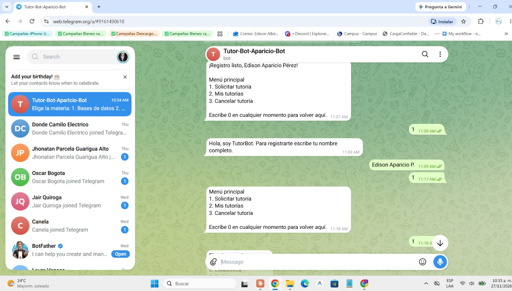
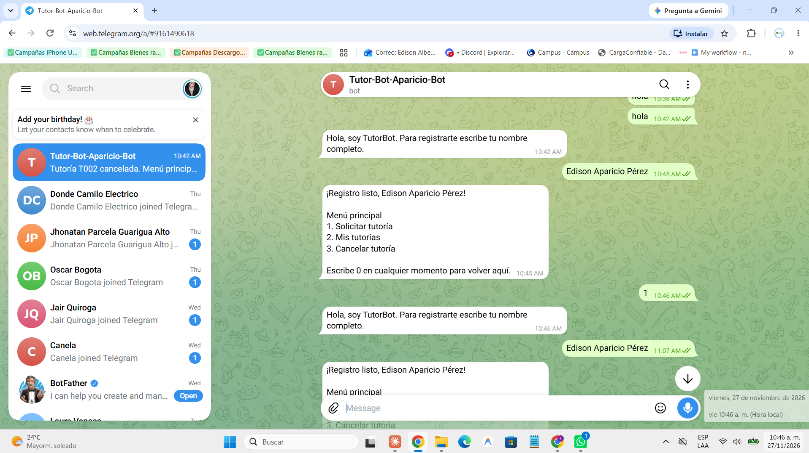
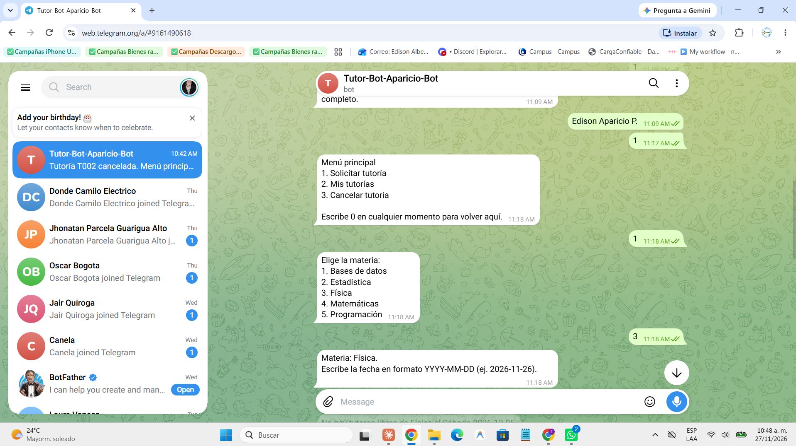
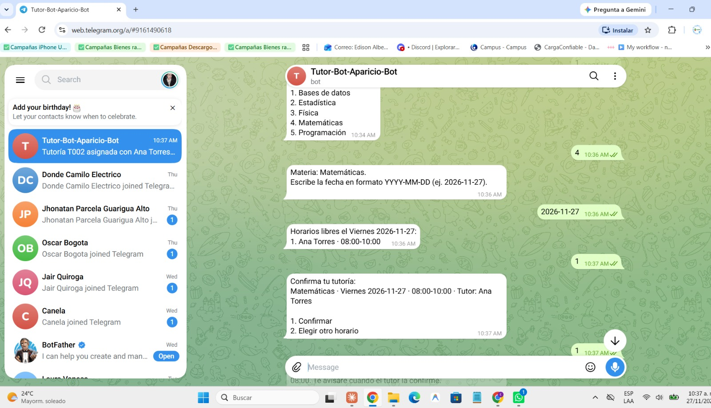
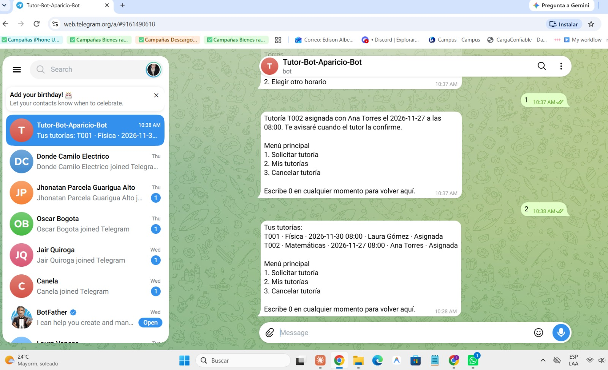
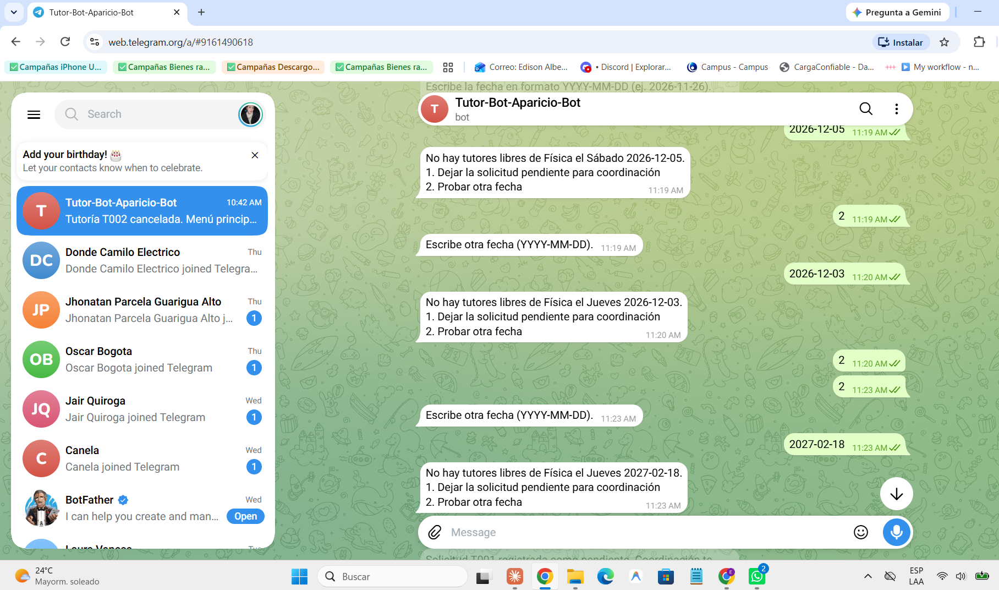

# TutorBot – Gestión automatizada de tutorías académicas

Bot de Telegram construido en **n8n** que conecta estudiantes con tutores según la materia y la disponibilidad, usando **Google Sheets** como base de datos. Gestiona la tutoría desde la solicitud hasta su finalización, evita la doble reserva y avisa al tutor y al estudiante en cada cambio de estado.

## Integrantes

- Edison Alberto Aparicio Pérez
- Juan David

## Tecnologías

- **n8n Cloud**: orquestación de la lógica (flujos y nodos Code en JavaScript)
- **Telegram Bot API**: interfaz conversacional
- **Google Sheets**: base de datos `TutorBot_DB`

## Arquitectura

```
Telegram ──► n8n (Flujo 1: Conversación) ──► Google Sheets (TutorBot_DB)
                 │
                 ├─ Flujo 2: Recordatorios (diario)
                 └─ Flujo 3: Reporte semanal para coordinación
```

**Flujo 1 – Conversación**

```
Telegram Trigger → Leer SESSIONS → Leer ESTUDIANTES → Leer TUTORES
→ Leer DISPONIBILIDAD → Leer TUTORIAS → Motor (Code)
   ├─ Enviar Respuesta (Telegram)
   ├─ Datos sesion → Guardar SESSIONS
   ├─ Estudiante nuevo → Guardar ESTUDIANTES
   ├─ Tutoria nueva → Guardar TUTORIAS
   ├─ Actualizar tutoria → Actualizar TUTORIAS
   └─ Notificaciones → Enviar aviso (Telegram)
```

El nodo **Motor** concentra la lógica: lee el estado de la sesión del usuario, decide la respuesta (máquina de estados del wizard) y devuelve qué hay que guardar o notificar. Las ramas siguientes solo ejecutan esa decisión.



## Modelo de datos (TutorBot_DB)

| Hoja | Columnas |
| --- | --- |
| TUTORES | id_tutor, nombre, especialidad_materias, estado, telegram_chat_id |
| DISPONIBILIDAD | id_dispo, id_tutor, dia_semana, hora_inicio, hora_fin, estado |
| TUTORIAS | id_tutoria, id_estudiante, id_tutor, materia, fecha, hora, estado, id_dispo, creado_en |
| SESSIONS | telegram_user, pantalla_actual, paso_actual, datos_parciales |
| ESTUDIANTES | id_estudiante, nombre, fecha_registro |
| REPORTES | fecha, total, asignadas, confirmadas, finalizadas, canceladas, pendientes, detalle |

**Estados de una tutoría:** Solicitada → Asignada → Confirmada → Finalizada (o Cancelada).

**Cómo se evita la doble reserva:** la disponibilidad es semanal. Antes de ofrecer una franja, el Motor verifica en TUTORIAS que el tutor no tenga otra tutoría activa en esa fecha y hora, y que el estudiante tampoco. La verificación se repite justo antes de guardar.

## Uso

**Estudiante**

| Mensaje | Acción |
| --- | --- |
| `/start` | Registro (pide el nombre) o menú principal |
| `1` | Solicitar tutoría: materia → fecha (YYYY-MM-DD) → horario → confirmar |
| `2` | Ver mis tutorías y su estado |
| `3` | Cancelar una tutoría |
| `0` | Volver al menú en cualquier momento |

**Tutor** (su chat id debe estar en la columna `telegram_chat_id` de TUTORES)

| Comando | Acción |
| --- | --- |
| `/agenda` | Ver sus próximas tutorías |
| `/confirmar T001` | Pasa la tutoría a Confirmada y avisa al estudiante |
| `/finalizar T001` | Pasa la tutoría a Finalizada y avisa al estudiante |

## Instalación

1. Crear un bot con @BotFather y guardar el token (no se sube al repositorio).
2. Subir `TutorBot_DB.xlsx` a Google Drive y abrirlo como Google Sheets. Aplicar Formato → Número → Texto sin formato a todas las hojas.
3. En n8n crear las credenciales de Telegram y de Google Sheets (Sign in with Google).
4. Importar los archivos de `/workflows` (Workflows → Import from File).
5. En cada nodo de Google Sheets seleccionar el documento TutorBot_DB y su hoja.
6. Publicar los flujos con el botón **Publish**.

## Pruebas realizadas

| Caso | Resultado |
| --- | --- |
| Registro de estudiante | Fila creada en ESTUDIANTES y menú mostrado |
| Solicitar tutoría con cupo | Tutoría Asignada y aviso al tutor |
| Fecha sin tutores disponibles | Opción de dejarla Solicitada para coordinación |
| Doble reserva | La franja ocupada no se vuelve a ofrecer |
| Tutor confirma / finaliza | Estado actualizado y aviso al estudiante |
| Cancelar | Estado Cancelada y la franja queda libre |

## Capturas







## Base de datos

Google Sheets compartido: _pegar aquí el enlace_
